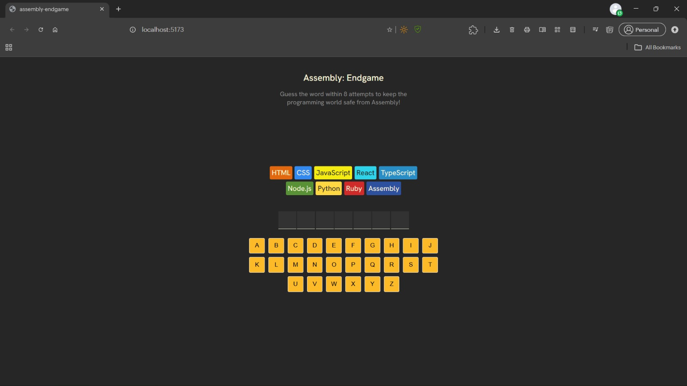
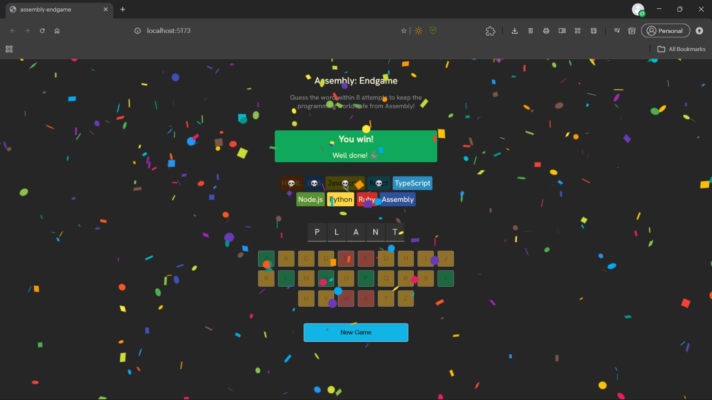
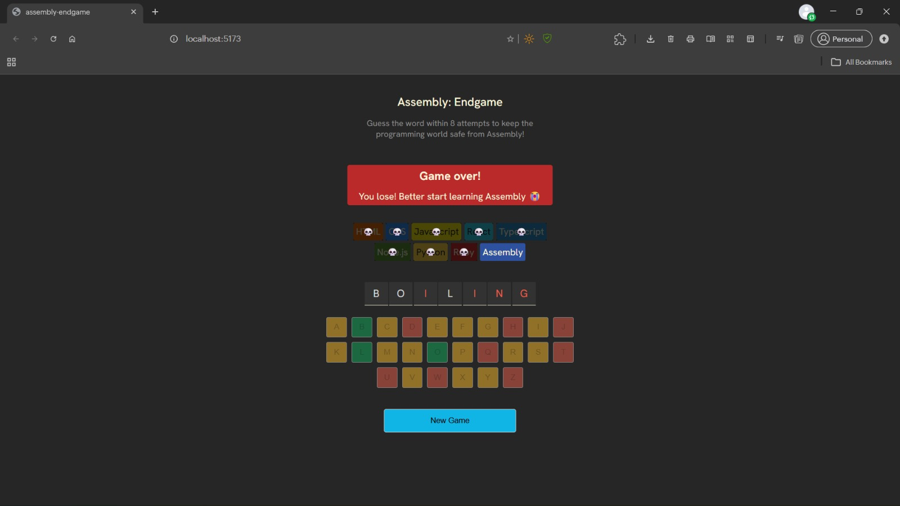

<div align="center">

# 🧑‍💻 Assembly: Endgame

**An interactive word-guessing game built with React, where you race against the programming languages to save Assembly from extinction.**

[](https://assembly-endgame-taupe-eta.vercel.app)


</div>

---

## 📖 Table of Contents

- [About the Project](#-about-the-project)
- [Screenshots](#-screenshots)
- [Features](#-features)
- [How to Play](#-how-to-play)
- [Tech Stack](#-tech-stack)
- [Getting Started](#-getting-started)
- [Available Scripts](#-available-scripts)
- [Project Structure](#-project-structure)
- [How It Works](#-how-it-works)
- [Roadmap](#-roadmap)
- [Contributing](#-contributing)
- [License](#-license)
- [Author](#-author)

---

## 🎯 About the Project

**Assembly: Endgame** is a twist on the classic word-guessing game. Every wrong guess knocks a programming language out of the race. Guess the hidden word before all the other languages are wiped out, or Assembly goes extinct along with them.

The project was built to practice and showcase core React concepts: component-driven UI, state management with hooks, derived state, conditional rendering, and dynamic class names.

---

## 📸 Screenshots

| Home | Winning | Game Over |
| :---: | :---: | :---: |
|  |  |  |

---

## ✨ Features

- 🔤 **Interactive on-screen keyboard** to guess letters one at a time
- 💀 **Language elimination system**: each wrong guess removes a programming language from the board
- 💬 **Farewell messages** that react to every language you lose
- 🎉 **Confetti celebration** when you win
- 🎲 **Random word selection** on every new game
- 🔁 **New Game button** to instantly reset and play again
- ⚡ **Fast development and builds** powered by Vite
- 📱 **Responsive layout** that works across screen sizes

---

## 🕹️ How to Play

1. A secret word is chosen at random and displayed as blank letter slots.
2. Click a letter on the keyboard to make a guess.
3. **Correct guess:** the letter is revealed in the word.
4. **Wrong guess:** one programming language is eliminated.
5. **Win:** reveal every letter before running out of guesses and Assembly survives.
6. **Lose:** all guesses are used up before the word is complete and Assembly goes extinct.

> 💡 Assembly is the last language standing, so choose your letters wisely.

---

## 🛠️ Tech Stack

| Technology | Purpose |
| --- | --- |
| [React](https://react.dev/) | UI library and state management (`useState`) |
| [Vite](https://vitejs.dev/) | Build tool and dev server |
| [clsx](https://github.com/lukeed/clsx) | Conditional CSS class names |
| [react-confetti](https://github.com/alampros/react-confetti) | Win celebration animation |
| [ESLint](https://eslint.org/) | Code linting and quality |
| [Vercel](https://vercel.com/) | Hosting and deployment |

---

## 🚀 Getting Started

### Prerequisites

- [Node.js](https://nodejs.org/) **v18 or higher**
- npm (bundled with Node.js)

### Installation

1. **Clone the repository**

   ```bash
   git clone https://github.com/sairam-saridi/assembly-endgame.git
   ```

2. **Navigate into the project directory**

   ```bash
   cd assembly-endgame
   ```

3. **Install dependencies**

   ```bash
   npm install
   ```

4. **Start the development server**

   ```bash
   npm run dev
   ```

5. Open the URL shown in your terminal (usually [http://localhost:5173](http://localhost:5173)) in your browser.

---

## 📜 Available Scripts

| Command | Description |
| --- | --- |
| `npm run dev` | Starts the development server with hot reload |
| `npm run build` | Creates an optimized production build in `dist/` |
| `npm run preview` | Serves the production build locally |
| `npm run lint` | Runs ESLint across the project |

---

## 📂 Project Structure

```text
assembly-endgame/
├── docs/
│   └── screenshots/        # README screenshots
│       ├── game-lost.jpeg
│       ├── homepage.jpeg
│       └── winning-game.jpeg
├── src/
│   ├── App.jsx             # Main game component and logic
│   ├── index.jsx           # React entry point
│   ├── index.css           # Global styles
│   ├── languages.js        # Programming languages data (name, colors)
│   ├── utils.js            # Helpers: getRandomWord, getFarewellText
│   └── words.js            # Word bank for the game
├── .gitignore
├── eslint.config.js        # ESLint configuration
├── index.html              # HTML template
├── LICENSE
├── package.json
├── package-lock.json
├── README.md
└── vite.config.js          # Vite configuration
```

---

## ⚙️ How It Works

The game follows React best practices by keeping a **minimal state** and calculating everything else as **derived values**.

### State

| State | Description |
| --- | --- |
| `currentWord` | The secret word, picked randomly on load via `getRandomWord()` |
| `guessedLetters` | Array of letters the player has guessed so far |

### Derived Values

| Value | Logic |
| --- | --- |
| `numGuessesLeft` | `languages.length - 1` (Assembly is the last one standing) |
| `wrongGuessCount` | Number of guessed letters that are not in `currentWord` |
| `isGameWon` | Every letter of `currentWord` is in `guessedLetters` |
| `isGameLost` | `wrongGuessCount >= numGuessesLeft` |
| `isGameOver` | `isGameWon \|\| isGameLost` |
| `isLastGuessIncorrect` | The most recent guess was wrong (triggers a farewell message) |

Because these values are computed on every render instead of being stored, the UI always stays in sync with the game state.

---

## 🗺️ Roadmap

- [ ] Add difficulty levels (easy / medium / hard)
- [ ] Track win/loss streaks with `localStorage`
- [ ] Add keyboard (physical) input support
- [ ] Add sound effects and a mute toggle
- [ ] Improve accessibility (ARIA live regions, screen reader support)
- [ ] Add unit tests with Vitest and React Testing Library

Have an idea? [Open an issue](https://github.com/sairam-saridi/assembly-endgame/issues) and let's discuss it.

---

## 🤝 Contributing

Contributions, issues, and feature requests are welcome!

1. **Fork** the project
2. **Create** your feature branch
   ```bash
   git checkout -b feature/amazing-feature
   ```
3. **Commit** your changes
   ```bash
   git commit -m "feat: add amazing feature"
   ```
4. **Push** to the branch
   ```bash
   git push origin feature/amazing-feature
   ```
5. **Open** a Pull Request

---

## 📄 License

Distributed under the **MIT License**. See [`LICENSE`](./LICENSE) for more information.

---

## 👤 Author

**Sairam Saridi**

- GitHub: [@sairam-saridi](https://github.com/sairam-saridi)
- Live Demo: [assembly-endgame-taupe-eta.vercel.app](https://assembly-endgame-taupe-eta.vercel.app)

---

<div align="center">

⭐ **If you enjoyed this project, please consider giving it a star!** ⭐

</div>
